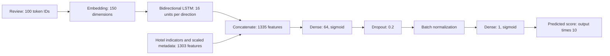

# Architecture and training setup

The notebook defines a configurable Keras model. The first `model.summary()` displays the defaults; the later search chooses different embedding and LSTM dimensions for final training.

| Component | Initial displayed model | Selected final configuration |
| :--- | ---: | ---: |
| Input sequence length | 100 | 100 |
| Embedding input size | 9,640 | 9,640 |
| Embedding dimension | 50 | 150 |
| LSTM units per direction | 64 | 16 |
| Bidirectional output width | 128 | 32 |
| Structured input width | 1,303 | 1,303 |
| Concatenated width | 1,431 | 1,335 |
| Hidden dense units | 64 | 64 |
| Dropout | 0.2 | 0.2 |

The structured input contains 1,298 one-hot hotel indicators and five numerical features: reviewer review count, hotel review count, day, month and year. The unknown token and padding both use zero. `len(word2idx) + 1` gives the embedding an additional unused row; masking is disabled in the submitted implementation.

The final configuration follows the `best_params` output and the `create_model` definition. Its parameter count, calculated from those layer dimensions, is **1,553,201** (1,553,073 trainable and 128 non-trainable). The recorded **632,849**-parameter summary belongs to the initial model. A summary for the selected model was not saved.

The loss is mean squared error on scores divided by ten. The search samples five configurations from 24 combinations using Python seed 42. Each receives two-fold validation and two epochs per fold. Final training uses the selected configuration for two epochs with validation monitoring, followed by evaluation on the held-out test set. Adam uses a learning rate of 0.0001 and batches of 64.

The TensorFlow and NumPy seeds are set to 42. Seeds alone do not guarantee identical results across TensorFlow versions, hardware and numerical kernels. The original environment and trained weights were not archived.
