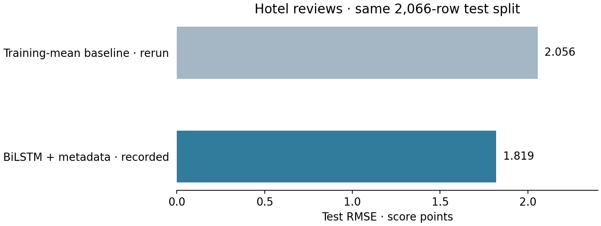

# Hotel review score regression

A dual-input neural network that predicts review scores from review text and hotel/reviewer metadata. The text branch uses a learned embedding and a bidirectional LSTM; its output is combined with structured features in a small dense network.

[Notebook](Deep-Learning-Hotel-Review-Regression-Project.ipynb) · [Architecture](ARCHITECTURE.md) · [Written design](docs/EXAM_DL.pdf)

## Results



| Model | MSE on normalized target | RMSE in score points |
| :--- | ---: | ---: |
| Training-mean baseline, computed November 2026 | 0.04226 | 2.056 |
| BiLSTM + structured features, recorded coursework run | 0.0331 | approximately 1.819 |

The neural result is the saved June 2025 notebook output. Its MSE was printed to four decimal places; the original-scale RMSE is calculated as `10 × sqrt(MSE)`. The baseline uses the same split and only the training mean. The neural model was not retrained for this comparison, and model weights were not saved. [Values, split sizes and data checksum](results/comparison.json) are included.

## Model and experiment

The 13,772-row course dataset is split into **9,640 training**, **2,066 validation** and **2,066 test** reviews with seed 42. Review scores are divided by ten during training.

- **Text:** punctuation removal, lowercase alphabetic tokens, training vocabulary, and sequences padded/truncated to 100 tokens.
- **Structured data:** one-hot hotel names and five scaled numerical/date features. `Review_Type` is excluded because it is directly related to the target.
- **Selection:** five sampled configurations, two-fold cross-validation and two training epochs per configuration.
- **Selected model:** 150-dimensional embeddings, 16 LSTM units per direction, a 64-unit sigmoid dense layer, dropout 0.2, batch normalization and a sigmoid output. Adam learning rate: 0.0001.

The notebook displays the initial model summary; [ARCHITECTURE.md](ARCHITECTURE.md) distinguishes it from the selected network.

## Run

```bash
git clone https://github.com/pdmdp/Deep-Learning-Hotel-Review-Regression-Project.git
cd Deep-Learning-Hotel-Review-Regression-Project
python -m pip install -r requirements.txt
python -m jupyter lab Deep-Learning-Hotel-Review-Regression-Project.ipynb
```

The notebook loads the included CSV directly. Run it from the repository root. Neural training requires a compatible TensorFlow environment; the original run used Colab, and its exact package versions were not retained. `requirements.txt` is a dependency list, not a verified historical lockfile.

The baseline runs independently of TensorFlow:

```bash
python -m pip install -r requirements-baseline.txt
python scripts/evaluate_baseline.py
```

This also regenerates the figure and machine-readable comparison. The baseline was verified with Python 3.14.4 and the versions in `requirements-baseline.txt`.

## Evaluation scope

This random review split does not test unseen hotels or future dates. Preprocessing is fitted before the inner cross-validation search, and padding shares an unmasked index with unknown words. The two-epoch search is small; [method notes](ARCHITECTURE.md#evaluation-limits) describe these limitations.

## Author and source

**Matteo Pietro Di Pilato** · Deep Learning coursework, June 2025, BSc in Artificial Intelligence (Universities of Pavia, Milan and Milano-Bicocca).

The dataset was supplied with the course assignment. The [MIT license](LICENSE) covers the project code; course materials and source data retain their own terms.
